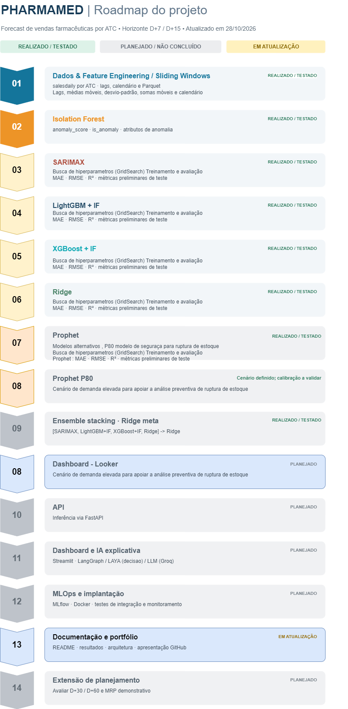
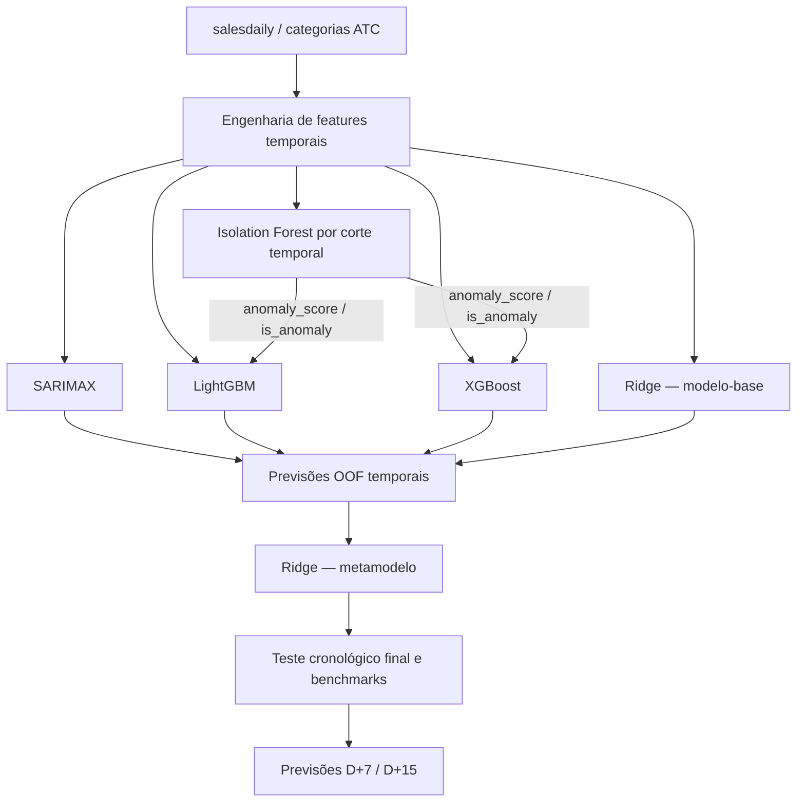
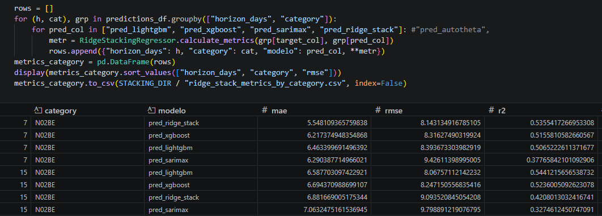

# PharmaDemand — Forecasting de Vendas Farmacêuticas com Ensemble Stacking

> **Projeto de portfólio em desenvolvimento** · Machine Learning · Séries temporais · Detecção de anomalias · Ensemble Learning

O **PharmaMed (PharmaDemand)** é um projeto de previsão de vendas diárias no varejo farmacêutico, organizadas por **categorias ATC**, com foco inicial nos horizontes **D+7 e D+15**. A proposta é combinar métodos estatísticos e algoritmos de Machine Learning para investigar se um *ensemble stacking* melhora a previsão em relação aos modelos individuais.

O projeto foi estruturado em duas frentes: **(1) modelagem, avaliação e treinamento** e **(2) disponibilização das previsões, visualização, explicações e MLOps**. A segunda frente permanece no roadmap.

**Estado atual (29/10/2026):** existem experimentos e avaliações de modelos individuais; a versão final do stacking e o ganho fora da amostra estão sendo avaliados, alguns ajustes estão sendo realizados. Os status do roadmap estão em constante atualização.



## 1. Problema de negócio

Prever vendas por categoria farmacêutica ajuda a apoiar estudos de:

- reposição e planejamento de estoques de curto prazo;
- identificação de variações incomuns de demanda;
- comparação de cenários e erros de previsão entre modelos;
- apoio a decisões analíticas, com hipóteses e limites explícitos.

A fonte utilizada é o conjunto público **[Pharma Sales Data](https://www.kaggle.com/datasets/milanzdravkovic/pharma-sales-data)**, com a tabela `salesdaily` e séries diárias por categoria ATC. Trata-se de **dados históricos de vendas**, não de uma base industrial completa de estoques, produção ou abastecimento. Portanto, **não** são reivindicados ganhos reais de estoque, redução de ruptura ou validação industrial.

## 2. Objetivos e escopo

| Item | Definição |
|---|---|
| Granularidade | Diária, por categoria ATC |
| Base do MVP | `salesdaily` |
| Horizontes | D+7 e D+15 |
| Previsão-alvo | Vendas / quantidade diária da categoria |
| Modelos-base propostos | SARIMAX, LightGBM + IF, XGBoost + IF, Ridge linear |
| Metamodelo proposto | Ridge Regression (segundo modelo, treinado sobre previsões dos modelos-base) |
| Feature de anomalia | Isolation Forest → `anomaly_score` e `is_anomaly` |
| Avaliação | MAE, RMSE, R²; consolidar WAPE e Bias |
| Extensões planejadas | D+30, D+90, D+180; simulação de suprimentos e MRP simplificado |

**Por que Ridge aparece duas vezes?** O **Ridge-base** é um regressor linear treinado com atributos temporais, usado como um quarto previsor e *baseline* interpretável. O **Ridge-metamodelo** recebe as previsões **out-of-fold** dos quatro modelos-base, aprende a combiná-las e passa por uma validação separada. São instâncias distintas, com entradas diferentes. Sua contribuição adicional precisará ser verificada por teste de ablação.

## 3. Arquitetura proposta



> **Observação metodológica:** o Isolation Forest é um detector de anomalias, **não** mais um regressor na camada base. Seus atributos somente podem ser calculados a partir dos dados disponíveis em cada origem temporal; o mesmo se aplica a lags, estatísticas móveis, transformações e variáveis exógenas do SARIMAX.

### Contribuições esperadas de cada componente

Durante o desenvolvimento do projeto, foram avaliados modelos adicionais que não integram a arquitetura final proposta. Esses modelos foram descartados por apresentarem desempenho inferior nos experimentos 
realizados com o conjunto de dados utilizado, considerando as métricas de avaliação e os horizontes de previsão definidos.
Uma abordagem alternativa para acelerar a experimentação seria utilizar ferramentas de Automated Machine Learning (AutoML), permitindo explorar diferentes algoritmos e configurações de hiperparâmetros 
de maneira automatizada.
Entretanto, neste projeto, optou-se por não utilizar AutoML, priorizando a seleção e a avaliação individual dos modelos. Essa abordagem permite maior controle sobre os experimentos, 
compreensão das características de cada algoritmo e análise de sua possível contribuição para o Ensemble Stacking.

A seleção dos modelos considera não apenas seu desempenho individual, mas também sua complementaridade e seu potencial de contribuir para a redução dos erros da previsão combinada.
| Componente | Papel no sistema |
|---|---|
| **SARIMAX** | Padrões de autocorrelação e sazonalidade modelados estatisticamente |
| **LightGBM + IF** | Padrões não lineares das variáveis temporais, incluindo atributos de anomalia |
| **XGBoost + IF** | Alternativa de boosting para testar erros complementares aos do LightGBM |
| **Ridge-base** | Referência linear regularizada para verificar o ganho de modelos mais complexos |
| **Ridge-meta** | Meta modelo


## 4. Preparação dos dados

A camada de engenharia de atributos contempla:

- **Variáveis temporais:** dia da semana, mês, fim de semana e calendário;
- **Defasagens:** lags dependentes do horizonte de previsão;
- **Estatísticas móveis:** janelas de 7, 15 e 30 dias, médias e somas;
- **Anomalias:** `anomaly_score`, `is_anomaly` e indicadores derivados;
- **Persistência:** DataFrames intermediários e artefatos Parquet.


## 5. Validação e metodologia

**Protocolo recomendado para concluir o ensemble:**

1. Separar cronologicamente treino, validação e teste final; o experimento utiliza como referência um holdout dos últimos seis meses.
2. Ajustar pré-processamento, Isolation Forest, seleção de features e hiperparâmetros **dentro** dos cortes de treino.
3. Gerar previsões OOF dos modelos-base por **origem de previsão, categoria ATC e horizonte**; registrar `(ATC, origem, horizonte, data-alvo)`.
4. Treinar o Ridge-metamodelo sobre as previsões OOF, sem usar o teste final.
5. Comparar o stacking com modelos individuais, média simples, baseline sazonal e versões sem determinados modelos (**ablation test**).
6. Publicar métricas por categoria e horizonte: **MAE, RMSE, R², WAPE e Bias**, informando número de previsões, período e convenção de horizonte.


### Resultados preliminares relatados

| Modelo individual | MAE ↓ | RMSE ↓ | R² ↑ | Condição |
|---|---:|---:|---:|---|
| SARIMAX | 6,320 | 8,262 | 0,437 | Experimento previamente relatado |
| LightGBM | 7,100 | 9,065 | 0,330 | Teste anteriormente relatado |
| XGBoost | 6,945 | 8,955 | 0,346 | Teste anteriormente relatado |
| Ridge-base | *.** | *.** | *.** | Teste anteriormente relatado |
| Stacking + Ridge-meta** | 5.55 | 8.14 | 0.53 | Teste anteriormente relatado D+7 |



> **Atenção:** números provenientes de execuções relatadas em momentos diferentes; **Não interpretar a tabela como um ranking científico definitivo nem como resultado de produção.**

## 6. Roadmap de execução

| Etapa | Status de referência | Entrega esperada |
|---|---|---|
| Dados e engenharia temporal | ✅ Testado | Dataset e features reprodutíveis |
| Isolation Forest | ✅ Trabalhado/testado | Scores e flags de anomalias |
| SARIMAX | ✅ Testado | Métricas individuais |
| LightGBM + IF | ✅ Testado | Métricas e tuning individual |
| XGBoost + IF | ✅ Testado | Métricas e tuning individual |
| Comparação individual | ✅ Preliminar | MAE / RMSE / R² |
| Ridge-base | ⬜ A validar | Baseline linear e métricas |
| Stacking + Ridge-meta | ⬜ Planejado | Ensemble e comparação contra baselines |
| Serialização e FastAPI | ⬜ Planejado | API para inferência e versionamento |
| Streamlit e IA explicativa | ⬜ Planejado | Painel, relatórios, LangGraph / LAYA / Groq e RAG |
| MLflow e Docker | ⬜ Planejado | Rastreio de experimentos e ambiente replicável |
| Documentação | 🟡 Em atualização | README, arquitetura e portfólio |
| D+30…D+180 e suprimentos | ⬜ Fase futura | Horizonte longo e simulação de cenários / MRP |

> ✅ significa que há **experimentação reportada**, não que o código esteja auditado ou implantado em produção. Todos os status devem ser revisitados antes de publicar o repositório.

## 7. Organização sugerida do repositório

A estrutura a seguir é a minha **proposta** estou realizando algumas alterações que devem ser replicadas em breve (04/11/2026)

```text
PharmaMed/
├── README.md
├── data/
│   ├── raw/                   # CSV original, quando permitido pela licença
│   └── processed/             # Parquets gerados
├── notebooks/                 # Análise exploratória, modelos e backtesting
├── src/
│   ├── features/              # Engenharia temporal e Isolation Forest
│   ├── models/                # SARIMAX, LightGBM, XGBoost e Ridge
│   ├── ensemble/              # OOF temporal e stacking (planejado)
│   └── evaluation/            # Avaliação e métricas
├── models/                    # Artefatos versionados (quando aplicável)
├── docs/
│   ├── roadmap_pharmamed.drawio
│   ├── roadmap_pharmamed.png
│   └── arquitetura_stacking.png
├── tests/                     # Testes de integridade e regressão
└── requirements.txt           # Se adotado no projeto
```


## 8. Tecnologias

**Utilizadas nos experimentos:** Python, Pandas, NumPy, scikit-learn, LightGBM, XGBoost, SARIMAX/statsmodels, Isolation Forest, Parquet, notebooks Jupyter e técnicas de busca/avaliação temporal.

**Planejadas para a fase de aplicação e operação:** FastAPI, Streamlit, Docker, MLflow, LangGraph, LAYA, Groq e RAG para explicações baseadas em regras e documentação.

**Benchmarks fora da composição principal:** Prophet, AutoETS, AutoTheta e outros modelos experimentais podem ser documentados separadamente. Eles não devem ser descritos automaticamente como integrantes da arquitetura final.

## 09. Limitações

Este projeto é **experimental e educacional**, baseado em dados públicos de vendas. Previsões não devem ser tratadas como decisões automáticas de aquisição, prescrição ou fabricação de medicamentos. 

**Dataset:** [Kaggle — Pharma Sales Data](https://www.kaggle.com/datasets/milanzdravkovic/pharma-sales-data). 

